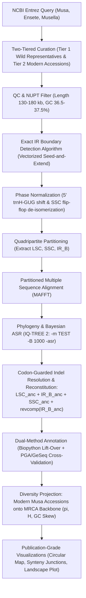

# Reconstruction and Comparative Architecture of the Hypothetical Ancestral *Musa* Plastome

[](https://www.python.org/downloads/)
[]()
[](https://opensource.org/licenses/MIT)

## 1. Project Overview

Chloroplast genomes (plastomes) of the monocot family Musaceae exhibit a canonical circular quadripartite architecture (~155–170 kb) comprising a **Large Single Copy (LSC)**, a **Small Single Copy (SSC)**, and two **Inverted Repeats ($\text{IR}_\text{A}$, $\text{IR}_\text{B}$)**. Despite widespread sequencing across wild and cultivated bananas, comparative structural analyses are hindered by technical and biological phenomena:

- **Arbitrary Linearization:** Inconsistent assembly start coordinates across GenBank deposits.
- **Structural Heteroplasmy:** Equimolar SSC flip-flop isomers generated by intramolecular homologous recombination between the Inverted Repeats.
- **Inverted Repeat Boundary Dynamics:** Dynamic expansion and contraction across junctions ($J_{LB}, J_{SB}, J_{SA}, J_{LA}$) capturing or truncating functional loci ($rps19$, $ycf1$).
- **Coding Frame Preservation:** Artifactual frameshifts introduced by naive consensus averaging of multiple sequence alignments.

This project delivers an end-to-end, reproducible computational genomics workflow to infer the **hypothetical ancestral plastome (Most Recent Common Ancestor, MRCA)** of the genus *Musa*, polarize evolutionary shifts against rooted Musaceae outgroups (*Ensete* and *Musella*), and project modern taxon-wide genetic diversity ($\pi$, $H$, structural indels) onto this ancestral coordinate backbone.

---

## 2. Methodology & Computational Architecture



---

## 3. Project Phasing & Timeline

| Phase | Milestone Description | Status |
| :---: | :--- | :---: |
| **Phase 0** | **Architectural & Biological Specification:** Mathematical formulation of MRCA reconstruction, outgroup selection (*Ensete*, *Musella*), and analytical pipeline design. | **Completed** |
| **Phase 1** | **Taxon Sampling, Ingestion & QC:** Automated NCBI Entrez pipeline, metadata structuring, GC content and NUPT filtering. | **Completed** |
| **Phase 2** | **Exact IR Detection & Phase Normalization:** Seed-and-extend detection of $[LSC, IR_B, SSC, IR_A]$ boundaries, $trnH\text{-GUG}$ circular standardization, and SSC flip-flop resolution. | **Completed** |
| **Phase 3** | **Partitioned MSA & Phylogenomics:** Partitioned MAFFT alignments and IQ-TREE 2 species tree inference with ModelFinder and 1,000 UFBoot. | **Completed** |
| **Phase 4** | **Bayesian Ancestral State Reconstruction (ASR):** Crown node state inference via IQ-TREE 2 `-asr`, parsimonious indel resolution, and circular quadripartite assembly. | **Completed** |
| **Phase 5** | **Feature Annotation & Biological Validation:** Alignment-guided lift-over, trans-spliced $rps12$ assembly, $\psi ycf1$ boundary checks, Table 11 translation audit, and PGA/GeSeq export. | **Completed** |
| **Phase 6** | **Diversity Projection & Scientific Visualization:** Sliding-window nucleotide diversity ($\pi$), Shannon entropy ($H$), GC skew, and publication figures adhering to Edward Tufte principles. | **Completed** |
| **Phase 7** | **Modular Notebook Packaging:** Verified execution across local Windows and Google Colab environments. | **Completed** |

---

## 4. Key Project Deliverables

1. **Modular 3-Part Jupyter Notebook Suite (`notebooks/`):**
   - `01_data_qc_normalization.ipynb`: Data retrieval, quality screening, exact IR detection, and structural de-isomerization.
   - `02_phylogeny_mrca_reconstruction.ipynb`: Partitioned MSA, IQ-TREE 2 phylogenetic modeling, empirical Bayesian ASR, and circular pseudomolecule assembly.
   - `03_annotation_diversity_visualization.ipynb`: Annotation lift-over, translation audit, diversity projection, and publication figure export.
2. **Reusable Python Computational Engine (`scripts/`):**
   - `config.py`: Environment autodetection (Colab vs Local) and publication style palettes.
   - `tool_resolver.py`: Cross-platform binary resolution for `iqtree2` and `mafft`.
   - `curation.py`: NCBI Entrez downloader, rate-limiter, and QC screening.
   - `ir_detector.py`: Vectorized seed-and-extend exact IR boundary identifier.
   - `normalizer.py`: Circular phase shifter and SSC orientation rectifier.
   - `phylogeny_asr.py`: Automated MAFFT aligner, IQ-TREE 2 ASR parser, and codon-guarded assembler.
   - `annotation.py`: Trans-spliced gene modeling, pseudogene delimitation, and NCBI Table 11 translation auditor.
   - `analytics.py`: Vectorized Nei & Li nucleotide diversity ($\pi$), Shannon entropy, and non-parametric tests.
   - `visualization.py`: 600 DPI publication figures with zero chartjunk (pycirclize, despined plots).
3. **Genomic Data Deliverables (`public/` and `data/`):**
   - Inferred ancestral *Musa* plastome sequence in FASTA format (`musa_mrca_plastome.fasta`).
   - Fully annotated GenBank record (`musa_mrca_plastome.gbk`).
   - Cross-validation bundles for PGA and GeSeq/ChloroBox.
   - High-resolution circular plastome map and multi-species synteny / junction shift figures.

---

## 5. Quickstart & Execution

### Local Environment (Windows / Linux / macOS)
```powershell
# 1. Clone repository
git clone https://github.com/satuankecepatan/musa-hypothetical-structure.git
cd musa-hypothetical-structure

# 2. Install dependencies
python -m pip install -r requirements.txt

# 3. Launch Jupyter
jupyter lab
```

### Google Colab Environment
Each notebook includes an automated bootstrap cell that detects Google Colab (`'google.colab' in sys.modules`), mounts the repository or clones it into `/content/`, installs missing dependencies quietly (`pip install -q ...`), and resolves `iqtree` and `mafft` via `apt-get`.
